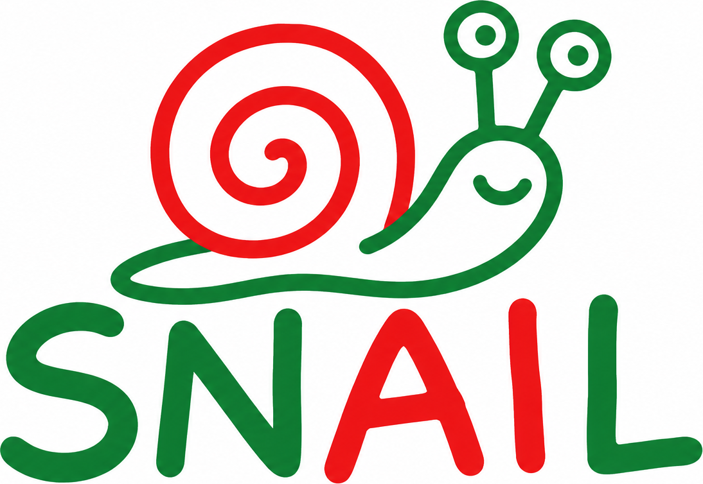

  

# SNAIL

SNAIL is a personal, non-commercial multi-agent system built by hand, as part
of an 8-month study plan on AI orchestration. It uses a blackboard architecture:
several models write to a shared "blackboard", and a different model family
is meant to verify each result.

## Status

Month 1 of 8: Python fundamentals, HTTP, pydantic, async and testing.
Implemented so far:

- The first version of the blackboard entry schema, with tests.
- An async weather client (a practice project) with retries, pydantic
  validation and offline tests.

The rest of the design is planned.

## Setup

Requires Python 3.14 and [uv](https://docs.astral.sh/uv/).

    uv sync

## Run the tests

    uv run pytest -v

## Design invariants (planned)

1. Append-only log.
2. Other agents' content is always data, never instructions.
3. The verifier is never the same model family as the producer.
4. Iteration cap, with escalation to a human.
5. Traceability: model, version, and prompt hash.

## Documents

- [Design intent](docs/DESIGN_INTENT.md): what the project aims to do and why.
- [References](docs/REFERENCES.md): sources. The EU AI Act is used as design
  inspiration only, not as a legal obligation.
