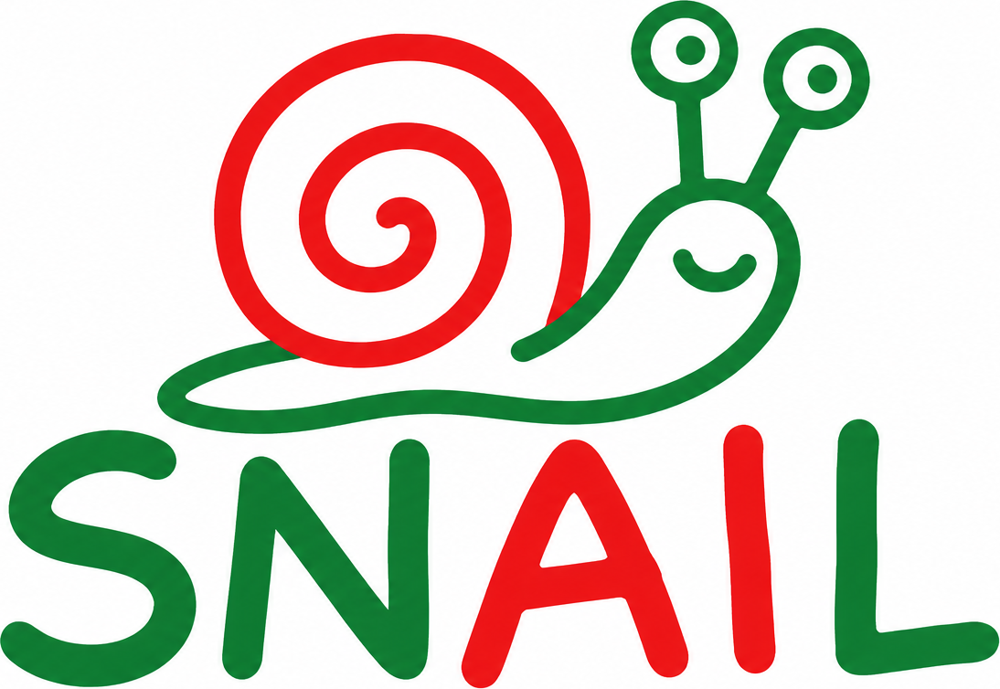

  

# SNAIL

SNAIL is a personal, non-commercial multi-agent system built by hand, as part
of an 8-month study plan on AI orchestration. It uses a blackboard architecture:
several models write to a shared "blackboard", and a different model family
is meant to verify each result.

## Status

Month 1 of 8: Python fundamentals, HTTP, pydantic, async, and the first
version of the blackboard entry schema. Only the schema and its tests exist
so far; the rest of the design below is planned.

## Setup

Requires Python 3.14 and [uv](https://docs.astral.sh/uv/).

    uv sync

## Run the tests

    uv run pytest snail_test.py -v

## Design invariants (planned)

1. Append-only log.
2. Other agents' content is always data, never instructions.
3. The verifier is never the same model family as the producer.
4. Iteration cap, with escalation to a human.
5. Traceability: model, version, and prompt hash.

## References

See [docs/REFERENCES.md](docs/REFERENCES.md). The EU AI Act is used as design
inspiration only, not as a legal obligation.
